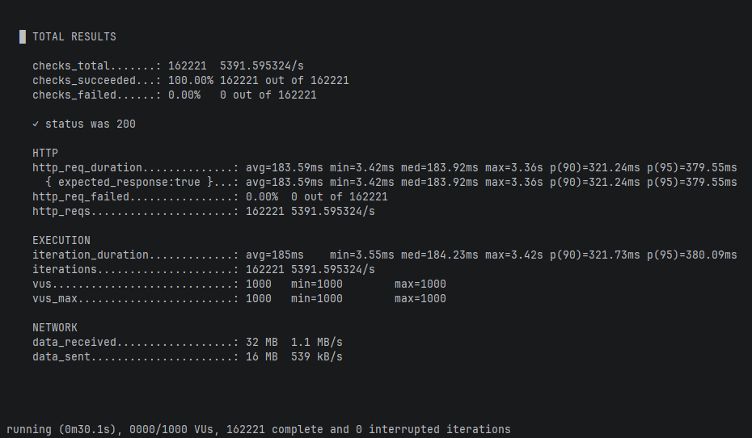

# Tickets Queue System

대규모 트래픽 환경을 가정한 **티켓 대기열 및 발급 시스템** 예제 프로젝트입니다.  
Kotlin Coroutines와 Redis를 활용하여 고성능의 비동기 처리를 구현하였으며, 동시성 이슈를 해결하는 방법을 보여줍니다.

## 기술 스택 (Tech Stack)

- **Language**: Kotlin 2.4 (Java 21)
- **Framework**: Spring Boot 4.1
- **Database**: Redis (Docker)
- **Concurrency**: Kotlin Coroutines
- **Build Tool**: Gradle 9 (Kotlin DSL)

## 주요 기능 (Features)

- **티켓 발급 API**: 사용자 ID를 기반으로 순차적인 티켓 번호를 발급합니다.
- **동시성 제어**: Redis의 `INCR` 명령어를 사용하여 원자적(Atomic)으로 카운트를 증가시켜, 경쟁 상태(Race Condition) 없이 고유한 번호를 보장합니다.
- **중복 방지**: 인메모리 캐시(`ConcurrentHashMap`)와 Redis를 조합하여 동일 사용자의 중복 요청을 효율적으로 처리합니다.
- **대기열 제한**: 최대 발급 가능한 티켓 수(예: 1,000,000개)를 제한하여 매진(Sold Out) 처리를 구현했습니다.

## 시작하기 (Getting Started)

### 1. 사전 요구사항 (Prerequisites)
- JDK 21 이상
- Docker & Docker Compose (Redis 실행용)

### 2. 인프라 실행 (Redis)
프로젝트 루트의 `infra` 폴더에 있는 `docker-compose.yml`을 사용하여 Redis 컨테이너를 실행합니다.

```bash
cd infra
docker-compose up -d
```
* Redis는 `6379` 포트로 실행되며, 비밀번호는 `redispassword`로 설정되어 있습니다.

### 3. 애플리케이션 실행
프로젝트 루트에서 다음 명령어로 애플리케이션을 실행합니다.

```bash
./gradlew bootRun
```

## API 사용법 (API Usage)

### 티켓 발급 요청
특정 사용자(`userId`)에게 티켓을 발급합니다.

- **URL**: `GET /ticket`
- **Query Param**: `userId` (String)

**요청 예시 (cURL):**
```bash
curl "http://localhost:8080/ticket?userId=user123"
```

**응답 예시 (JSON):**
```json
{
  "uuid": "550e8400-e29b-41d4-a716-446655440000",
  "ticketNumber": 1
}
```
* `uuid`: 발급된 티켓의 고유 식별자
* `ticketNumber`: 발급된 순서 번호

## 부하 테스트 (Stress Test)

[k6](https://k6.io/)를 사용하여 티켓 발급 API에 부하를 주는 스크립트가 `stress-test/stress-test.js`에 포함되어 있습니다.  
k6를 별도로 설치하지 않고 Docker 이미지(`grafana/k6`)로 실행합니다.

- **가상 사용자(VUs)**: 1,000명
- **테스트 시간**: 30초
- **요청**: 1 ~ 100,000 사이의 랜덤 `userId`로 `GET /ticket` 호출
- **검증**: 응답 상태 코드가 `200`인지 확인

### 1. 사전 준비
Redis와 애플리케이션이 실행 중이어야 합니다. ([시작하기](#시작하기-getting-started) 참고)

### 2. 실행
`stress-test` 폴더에서 아래 명령어를 실행합니다.

**Bash (macOS / Linux / Git Bash):**
```bash
cd stress-test
docker run --rm -i grafana/k6:1.5.0 run - < stress-test.js
```

**PowerShell (Windows):**
```powershell
cd stress-test
Get-Content stress-test.js | docker run --rm -i grafana/k6:1.5.0 run -
```

* 컨테이너 안에서 호스트의 애플리케이션에 접근하기 위해 `host.docker.internal:8080`을 사용합니다.
  Linux에서는 `host.docker.internal`이 기본으로 제공되지 않으므로 `--add-host=host.docker.internal:host-gateway` 옵션을 추가하세요.
  ```bash
  docker run --rm -i --add-host=host.docker.internal:host-gateway grafana/k6:1.5.0 run - < stress-test.js
  ```
* 가상 사용자 수와 테스트 시간은 `--vus`, `--duration` 옵션으로 변경할 수 있습니다.
  ```bash
  docker run --rm -i grafana/k6:1.5.0 run --vus 100 --duration 10s - < stress-test.js
  ```

### 3. 결과 확인
테스트가 끝나면 k6가 요약 결과를 출력합니다. 주요 지표는 다음과 같습니다.

* `checks`: `status was 200` 검증 성공 비율
* `http_reqs`: 총 요청 수 및 초당 요청 수(RPS)
* `http_req_duration`: 응답 시간 (avg, p90, p95 등)
* `http_req_failed`: 실패한 요청 비율



### 4. 데이터 초기화
발급된 티켓 정보는 Redis에 남아 있으므로, 테스트를 처음 상태에서 다시 하려면 Redis 데이터를 지우고 애플리케이션을 재시작합니다.  
(중복 발급 방지용 인메모리 캐시도 함께 초기화해야 하기 때문입니다.)

```bash
docker exec ticket-redis redis-cli -a redispassword FLUSHALL
```

## 프로젝트 구조

```
tickets-queue/
├── src/main/kotlin/com/example/ticketsqueue/
│   ├── controller/    # 웹 요청 처리 (TicketController)
│   ├── service/       # 비즈니스 로직 (TicketService - Redis 연동)
│   ├── dto/           # 데이터 전송 객체
│   └── exception/     # 예외 처리
├── infra/
│   └── docker-compose.yml  # Redis 설정
├── stress-test/
│   └── stress-test.js # k6 부하 테스트 스크립트
└── build.gradle.kts   # 프로젝트 의존성 관리
```
